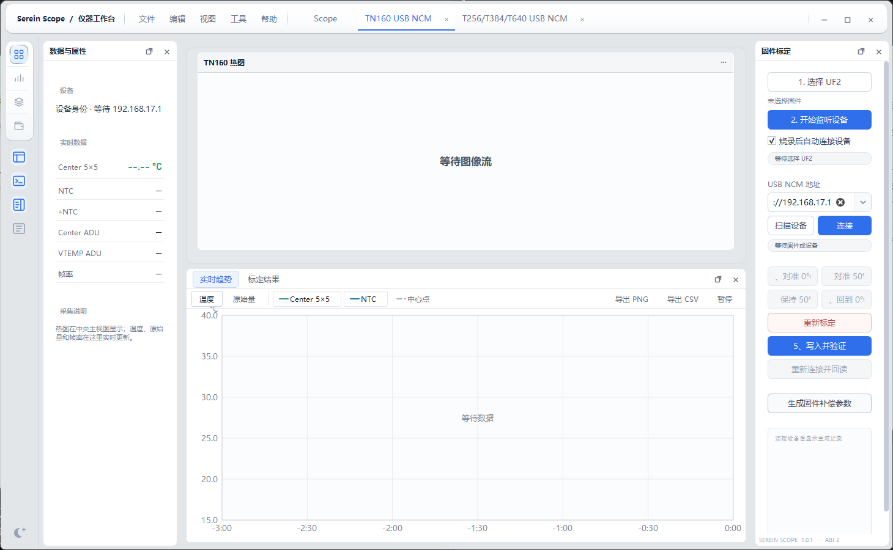

<header class="resource-page-head">
桌面调试仪器 / Windows x64
<h1>Serein Scope</h1>
让设备数据成为可用的工作台

用独立组件组织串口、热成像与机群模拟。连接、测量、诊断和面板布局各有明确入口。

<a class="resource-button" href="/products/scope/getting-started"><SiteIcon name="grid" />开始使用</a><a class="resource-text-link" href="/downloads/#scope"><SiteIcon name="download" />版本与下载 →</a>
</header><figure class="resource-product-capture"><figcaption>Scope 1.0.1 · TN160 USB NCM 工作区。设备未连接时保留连接入口与状态说明。</figcaption></figure><dl class="resource-features">
<dt>组件工作台</dt><dd>按任务导入独立组件，加载后打开工作区，按需调整面板。</dd>

<dt>数据与诊断</dt><dd>串口波形、热图、测量和模拟预览使用对应组件与实际输入。</dd>

<dt>独立扩展</dt><dd>七款标准组件分别维护，Core SDK 提供原生组件接口和构建模板。</dd>
</dl>
<section class="resource-section"><h2>从这里继续</h2>
<a href="/products/scope/getting-started">01<h3>快速开始</h3>
安装、首次运行与基本工作流。
</a><a href="/products/scope/user-guide">02<h3>用户手册</h3>
工作区、日常操作与常见问题。
</a><a href="/products/scope/release-notes">03<h3>版本说明</h3>
适用版本、兼容性与使用范围。
</a>
</section><section class="resource-product-next"><a href="/products/scope/components"><SiteIcon name="grid" />浏览组件库 →</a><a href="/support/"><SiteIcon name="support" />获取支持 →</a></section>

